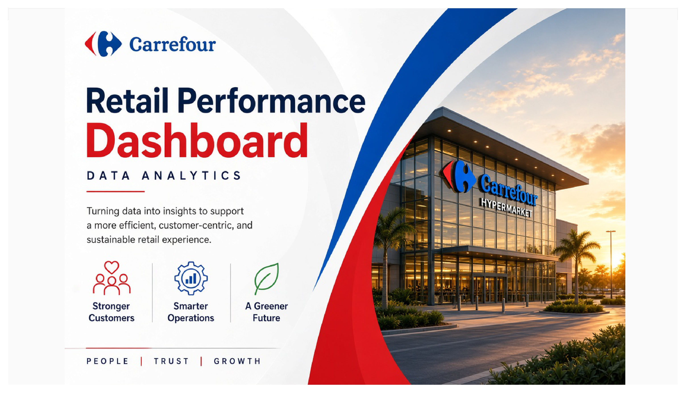
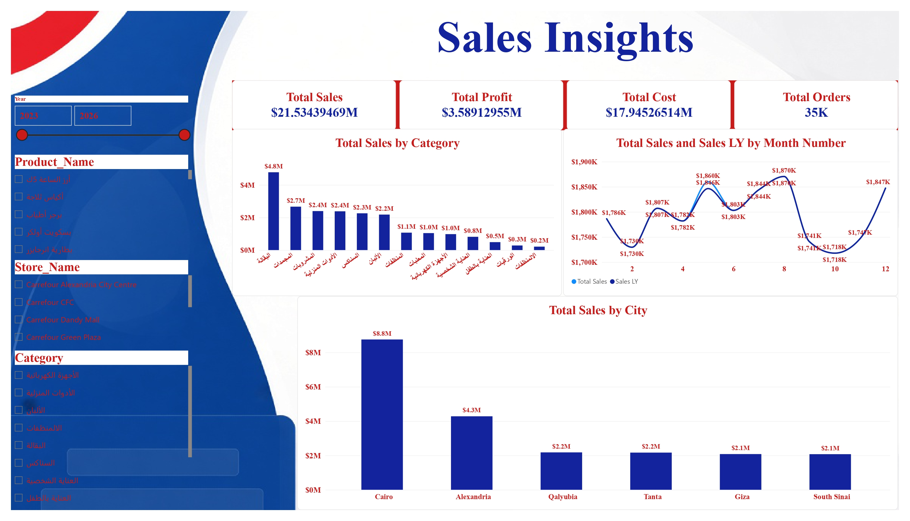
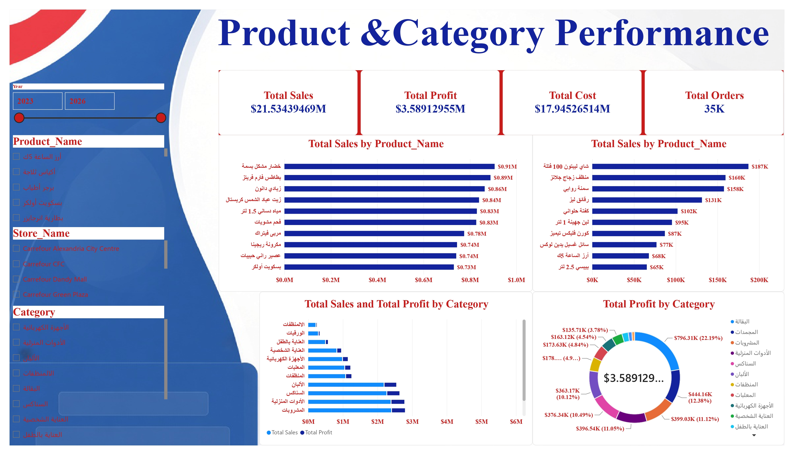
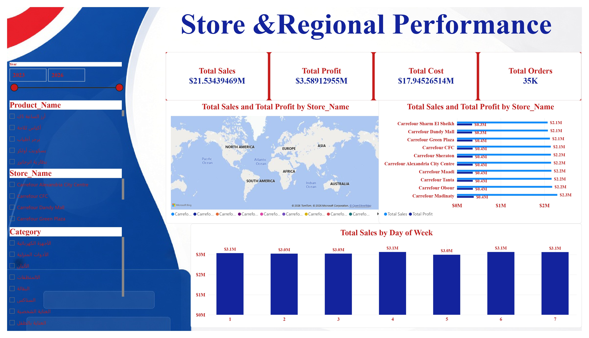

# 🛒 Carrefour – Retail Performance Dashboard (Power BI)



A Power BI project that analyzes retail performance across categories, products, stores, and cities, covering sales, profit, cost, and orders.

In this project, I imported the data into Power BI, cleaned and transformed it using Power Query, and built an interactive 3-page report with page navigation, slicers, and a custom branded design. The product and category data is in Arabic, so the report works with right-to-left product and category names.

---

## 🎯 Project Objective

To build an interactive retail report that helps management answer questions such as:

- 💰 How much did we sell, and how much profit did we make?
- 📦 Which categories and products drive the most sales and profit?
- 🌆 Which cities and stores perform best?
- 📅 How do sales trend across months compared to last year?
- 🗓️ Does performance change across the days of the week?

---

## 🛠️ Tools Used

- 📊 **Microsoft Power BI Desktop** – data modeling, visualization, navigation, and interactivity
- 🔄 **Power Query** – data import and transformation
- 🧹 **Data Cleaning** – preparing the data for analysis

---

## 🧹 Data Preparation

The data was imported into Power BI and prepared using Power Query.

The preparation included:

- 🔍 Reviewing the dataset structure and column types
- 🧹 Cleaning inconsistent and missing values
- 📅 Preparing date fields (year, month number, day of week)
- 🏷️ Standardizing product, category, store, and city names

---

## 📊 Report Pages

### 1️⃣ Sales Insights

A high-level summary of sales performance.

- 💰 Total Sales, Total Profit, Total Cost, Total Orders
- 📦 Total Sales by Category
- 📈 Total Sales vs Sales Last Year by Month
- 🌆 Total Sales by City
- 🎛️ Slicers: Year, Product, Store, Category



---

### 2️⃣ Product & Category Performance

Focuses on products and categories.

- 🏆 Top 10 products by Total Sales
- ⚠️ Lower-selling products by Total Sales
- 📊 Total Sales and Total Profit by Category
- 🍩 Total Profit by Category (share %)



---

### 3️⃣ Store & Regional Performance

Compares stores and trading days.

- 🏬 Total Sales and Total Profit by Store
- 🗺️ Store map
- 🗓️ Total Sales by Day of Week



---

## 🎛️ Interactive Features

- 🎛️ Slicers: Year, Product, Store, Category
- 🔍 Cross-filtering between visuals
- 🧭 Page navigation buttons
- 🎨 Custom branded design with Arabic (RTL) data support

---

## 📌 Key Results

| KPI | Result |
|---|---:|
| 💰 Total Sales | **$21.53M** |
| 💵 Total Profit | **$3.59M** |
| 🧾 Total Cost | **$17.95M** |
| 📊 Profit Margin (Profit ÷ Sales) | **≈ 16.7%** |
| 🛒 Total Orders | **35K** |

> Figures are as displayed in the report (rounded). Profit Margin is calculated from the Total Profit and Total Sales cards.

---

## 💡 Key Insights

- 📦 **Groceries (البقالة)** was the top category by sales (**$4.8M**) and by profit (**$796.31K, 22.19%** of total profit), followed by Frozen (المجمدات) at **$2.7M** in sales.
- 🌆 **Cairo** led sales by city with **$8.8M** (about 41% of total), followed by Alexandria (**$4.3M**). The other cities were close together at about **$2.1M–$2.2M**.
- 🏬 Store sales were very even, ranging from **$2.1M** to **$2.3M**. **Carrefour Madinaty** was the highest at **$2.3M**.
- 🗓️ Sales were nearly flat across the days of the week (**$3.0M–$3.1M** per day).
- 📈 Monthly sales stayed between about **$1.72M and $1.87M**.
- 🏆 The top product by sales was **خضار مشكل بسمة** (**$0.91M**).

---

## 🔄 Workflow

```text
Raw Data
   ↓
📥 Import Data (Power BI)
   ↓
🧹 Power Query – Cleaning & Transformation
   ↓
🗂️ Data Model
   ↓
📊 Visuals & KPIs
   ↓
🎛️ Interactive 3-Page Report
   ↓
💡 Business Insights
```

---

## 👩‍💻 Author

**Eman Sayed Seddik**
🔗 [LinkedIn](https://www.linkedin.com/in/eman-sayed-seddik-59bb1616a/)
